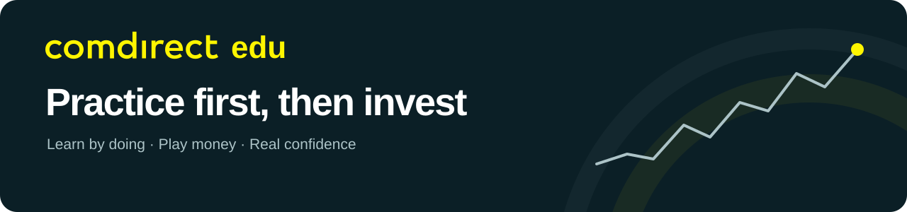
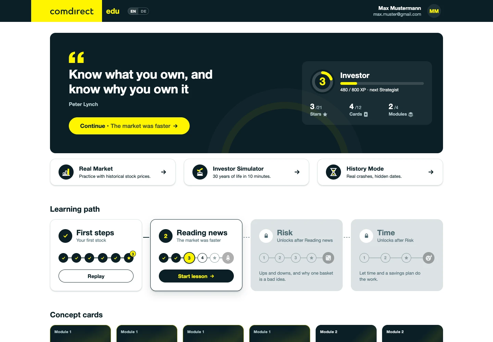
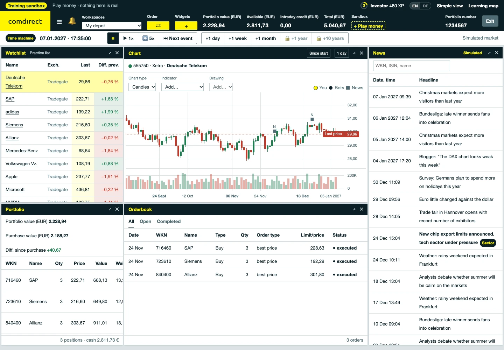
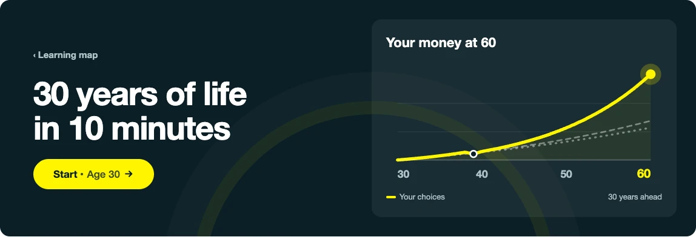
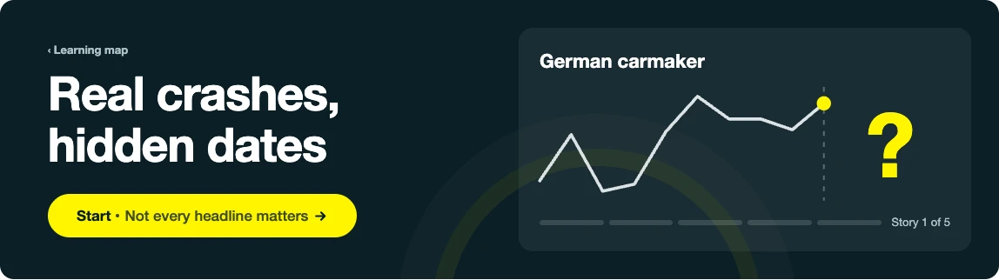

<p align="center">
  
</p>

<p align="center">
  
  
  
  
  
  
</p>

A play-money training sandbox on the real comdirect screens that guides first-time investors, from 22 to 58, step by step to their first stock trade.

**No theory first: you act from the very first minute, and every concept sticks because you just did it yourself.**

[View the pitch presentation (PDF)](docs/finance-quest.pdf)

<table>
  <tr>
    <td width="50%" valign="top">
      <a href=".github/assets/learning-hub.webp"></a>
      <br><strong>Your next confident step</strong><br>Guided missions, visible progress and a learning path that grows with you
    </td>
    <td width="50%" valign="top">
      <a href=".github/assets/protrader.webp"></a>
      <br><strong>Practise on familiar screens</strong><br>The comdirect-style trading workspace, with play money and a time machine
    </td>
  </tr>
  <tr>
    <td width="50%" valign="top">
      <a href=".github/assets/investor-simulator.webp"></a>
      <br><strong>30 years in 10 minutes</strong><br>See how today's decisions shape your future
    </td>
    <td width="50%" valign="top">
      <a href=".github/assets/history-mode.webp"></a>
      <br><strong>Real events, your decisions</strong><br>Replay market turning points before the dates are revealed
    </td>
  </tr>
</table>

## Why

Germans save a lot but invest too little. The barrier is not information, it is fear of the first step: the trading screen is unfamiliar, the terms are unclear, and reacting to news feels risky.

comdirect already has the pieces, but they live apart:

| | Musterdepot | Akademie | **comdirect edu** |
|---|:---:|:---:|:---:|
| Play money | ✅ | — | ✅ |
| Real comdirect layout | partly | — | ✅ |
| Guidance on every element | — | — | ✅ |
| Learn by doing | — | — | ✅ |
| Consequences in seconds | — | — | ✅ |
| Fits your life stage | — | — | ✅ |
| Reason to come back | — | — | ✅ |

## What's inside

| Mode | What you do |
|---|---|
| **Guided tour** | A spotlight coach explains each element of the web cabinet in one or two sentences, then hands you a mission: top up, search, buy your first stock |
| **Market simulator** | One simple trading screen with a live news feed and time that moves |
| **ProTrader** | An exact replica of the comdirect ProTrader layout, so you are fluent in the real workspace before you buy your first stock |
| **History mode** | Replay real market moments and see how your decisions would have played out |
| **Investor simulator** | A life-long savings run: income, events and choices, decade by decade |
| **Learning map** | Tutorials, concept cards, mini games, quick-check quizzes and bosses |

### One path, three life stages

Three onboarding questions pick a persona, and everything is tailored to it: examples, amounts, missions and bosses all match your life stage.

| Persona | Example | Start money | Savings plan | Focus |
|---|---|---:|---:|---|
| **Starter** | Lena, 22 | 100 € | 25 €/month | Compound interest, not chasing hype |
| **Builder** | Kaya family, 34 | 500 € | 50 €/month | Diversification, staying calm in a crash |
| **Pre-retiree** | Helga, 58 | 1.000 € | 100 €/month | Horizon, drawdown, why "cheap" isn't "safe" |

## How the game works

**The rule: we reward understanding and good decisions, never trading volume or guessing prices.** That keeps the game on the safe side of what regulators (ESMA, BaFin) criticise in "gamified" retail trading.

| Element | How it works |
|---|---|
| **Missions** | The coach steps back and you do it alone. 1–3 stars: done, done without hints, done with the smart choice (for example a limit order at night) |
| **XP and ranks** | XP for tour steps, missions, right concept answers and good decisions. Ranks: Saver → Beginner → Investor → Strategist → Market Reader |
| **Concept cards** | 12 to collect. Front: one sentence. Back: an example and a quiz question |
| **Spot the habit** | When a bot trades you name the risk behind it, not whether the price will go up. XP for the right concept, whatever the outcome |
| **Mistake Cam** | After the outcome, a short replay of what the bot did, what really happened and the concept behind it |
| **Boss rounds** | Tutorials 2–4 each end against one bot: FOMO Max, All-in Alex, Panic Paula. In History mode the same bosses return on real events with the date hidden (GameStop 2021, Wirecard 2020, the COVID crash 2020), revealed at the end |
| **Leaderboard** | You vs. the bots by risk-adjusted score (return − ½ × worst drawdown), so all-in gambling rarely wins |

## Fit with the Finance Quest challenge

| The challenge card asks for | What comdirect edu does |
|---|---|
| Bridge the gap between financial knowledge and action | You buy your first stock yourself, on the real comdirect screens, before you ever risk real money |
| A demonstrable prototype with a complete learning mission | Tutorial 1 mission **"Your first stock"**: move your money to the trading account, buy with a limit order, jump one week ahead, find your profit and loss. Checked against the sandbox state, not a quiz |
| The target learner and learning objective | **Learner:** self-directed savers who have never bought a stock. **Objective:** place a first trade with confidence and understand market vs. limit orders, fees and profit & loss |
| How the experience supports understanding and engagement | Spotlight tour where you do every step, concept cards, missions, rival bots, boss rounds, and History mode replays of real events |
| Fit with "Innovations for all generations" | Three onboarding questions pick a persona (22, 34 or 58), which changes the amounts, examples, missions and bosses |

## Why it's good for Commerzbank

- **Savers become investors.** Commerzbank's own Anlagestudie 2026 found that Germans save a lot and invest too little. edu turns the fear of the first step into a first trade.
- **A path into the real depot.** Every journey ends at **"Ready for real?"**, one click from the sandbox to the real comdirect portfolio.
- **Lives inside comdirect.** One banner on the start page. No sign-up, no new app, built on comdirect's own screens.
- **Customers for every life stage.** From a 22-year-old with a 25 € savings plan to a 58-year-old preparing for retirement.

## What we copy and what we invent

**Copied 1:1 from comdirect:** start page, account table, depot overview, transactions, search, security detail page, order form, and the ProTrader workspace with its widgets. Layout, element positions, table columns, field order and the German number and date formats (`1.001,16 EUR`, `14.03.2024`) match the real screens. The app runs in English and German (EN/DE switch in the header).

**Invented by us:** the entry banner, onboarding and personas, the spotlight coach, missions, XP, ranks, cards and stars, the simple trading area between the web cabinet and ProTrader, the time machine, historical replays, rival bots, Spot the habit, Mistake Cam, boss rounds, the leaderboard and the clearly marked "Add play money" sandbox button.

## What works today

| | |
|---|---|
| ✅ **Working** | Onboarding with three personas · all four tutorials end to end, each with a mission and a boss · five History replays (Wirecard, GameStop, VW, NVIDIA, COVID crash) · investor simulator · learning map with XP, ranks, stars and cards · ProTrader replica with the time machine · Real Market with historical quotes and intraday charts · backend progress saving in PostgreSQL · English and German |
| 🟡 **Simulated on purpose** | Tutorial prices are scripted; Real Market uses historical quotes · all trades use play money · the photoTAN step is a mock · "Ready for real?" links to comdirect.de |
| 🔜 **Planned integration** | Customer profile and identity from the bank platform · progress linked to that identity across devices · MCP access for the customer's own agent |

## Tech stack

| Layer | Technology | What it does |
|---|---|---|
| **Frontend** | TypeScript, React 19, Next.js 16 App Router | The comdirect-style screens, guided missions, learning map and interactive simulators |
| **Simulation** | Our TypeScript market and game engines | Run play-money trades and check mission actions in the browser; calculate XP, stars and learning progress |
| **Charts** | TradingView lightweight-charts | Draw candlestick, volume and historical price charts |
| **Backend** | Node.js, Next.js Route Handlers | Load and save progress through `/api/save`; serve intraday quotes through `/api/real-market/bars` |
| **Database** | PostgreSQL, Postgres.js (`postgres`) | Store each learner's save as JSONB, with an ID and update timestamp |
| **Market data** | Bundled Yahoo Finance daily quotes; Python, uv, yfinance and exchange-calendars | Supply historical daily data and server-side intraday bars for Real Market; an optional local archive supports older intraday data |
| **Deployment** | Docker, Docker Compose, Caddy, VPS | Run the app and Python worker in a container, connect to PostgreSQL and serve the app over HTTPS |
| **Quality** | ESLint, `node:assert` | Check code quality and verify the simulation's money math and scenario rules |

The frontend and backend are part of the same Next.js application. PostgreSQL runs as a separate service. No paid API subscription is required for the prototype.

### Platform data and learning progress

**The bank platform provides the customer context; edu stores the learning journey.** In the intended integration, the customer opens edu from their existing signed-in comdirect session. Their identity and profile details come from the platform, so they do not create another account or enter the same details again. The platform remains the source of truth for customer data.

Our backend stores what the learner does in edu: onboarding answers and persona, completed chapters and missions, XP, collected cards, stars, concept-answer progress, unlocked features, the current task, play-money account state and transactions, and the Investor Simulator personal best. Ranks are calculated from XP. These are practice balances and trades.

The data flow is:

1. **comdirect platform → edu:** provide the signed-in customer identity and relevant profile context through a future bank integration.
2. **edu frontend → edu backend → PostgreSQL:** save the learning and sandbox state as the customer practises.
3. **PostgreSQL → edu backend → edu frontend:** restore progress when the customer returns. Linking saves to the platform identity would also allow progress to follow them across devices.

**In the current prototype,** the progress backend is implemented, while the bank connection is still planned. The profile is the fixed "Max Mustermann" placeholder, and an anonymous browser cookie identifies each save. See [Saving progress](#saving-progress) for the current behaviour.

### MCP integration — planned

We plan to expose app help and learning context through **Model Context Protocol (MCP)**, so customers can use their own compatible agent while practising. They could ask "What does this field mean?", "Why use a limit order here?" or "What should I try next?" and get an explanation grounded in the app and their current learning step.

This extends the learning loop: **get a hint → try it → get feedback → understand why → ask your agent if still unsure**. MCP support is not yet implemented on `main`. The planned integration would expose authorised app and learning context; real trading remains in the bank's existing services.

## Behind the build

**How the pieces fit.** One deterministic engine ([`engine.ts`](src/features/market/engine.ts)) holds the account, fees (4,90 € + 0,25 %), orders and scripted prices. Every screen reads from it: the web cabinet, the simple trading area, ProTrader and the replays. The tour and missions check the sandbox state ("does the depot hold the stock, bought with a limit order?"), not a quiz answer.

**Key decisions.**
- **Deterministic markets.** Prices depend only on the scenario, never on the player, so every demo and every test plays the same way and only the account needs saving.
- **One tutorial step = one trading day.** Enough to show news, orders and compounding. Real Market separately supports historical daily and intraday charts.
- **A focused backend.** Next.js handles progress storage in PostgreSQL and intraday market-data requests. The browser runs the learning and simulation logic; the server persists the resulting save.
- **Reuse the bank identity.** The intended product gets customer details from the signed-in comdirect platform and adds a learning record keyed to that identity. The prototype uses a placeholder profile ([`user.ts`](src/shared/lib/user.ts)) and an anonymous save cookie until that integration is connected.
- **Code by feature** (`src/features/*`), with thin routes in `src/app/`.

**Built on:** Next.js, React, PostgreSQL, Postgres.js, lightweight-charts and the Python market-data tools listed above.
**Built by us during the hackathon (20–22 Nov 2026), about 50 commits:** everything else. The market engine, scenarios, replays and bots, the tour and missions, the game systems, the comdirect replica screens, the investor simulator and the German translation.

## Challenges and what we learned

- **The scoring rewarded luck.** In our first COVID replay FOMO Max bought at the record high and still won the round, which taught the wrong lesson. We rescripted it and score by risk-adjusted return (return − ½ × worst drawdown), so all-in play rarely wins.
- **We dropped "guess the price direction".** It rewarded guessing, exactly what regulators criticise in gamified trading. "Spot the habit" replaced it: you name the risk, not the next price.
- **Fake company news.** Our first news generator wrote headlines like "SAP opens office in Lisbon". We made "never invent news about a real company" a rule, and the self-check enforces it.
- **The Starter couldn't afford the replays.** With 100 €, one Wirecard share plus the fee is out of reach and diversifying is impossible. Replays now give everyone a 1.000 € budget and score in %.
- **A visible name spoils the replay.** Nobody makes a real decision on Wirecard if they know it's Wirecard, so replays hide the company name and date until the reveal.

## Results and next steps

**What we achieved.** A complete learning path from the comdirect start page to a first trade, three bosses and five replays of real market events, all on screens that match comdirect.

**How we validated it.** `npm run check` asserts the money math, order fills and expiry, 120 savings-plan executions over ten years, the replay prices, that every boss loses to the careful strategy, and that no simulated news is about a real company. We played all four tutorials end to end.

**What we're most proud of.** The first-stock mission: you move money, buy with a limit order and find your profit, on a 1:1 comdirect replica, with nobody holding your hand.

**Current limitations.**
- Tutorial simulations use one price per trading day with a fixed spread; dividends and tax are not modelled.
- Rival bots only appear in the History replays, not in free play.
- The bank profile/identity connection and MCP integration are planned; current saves follow a browser rather than a customer across devices.
- Not tested with real first-time investors yet.

**Next.**
- Test with real first-time investors and measure who places a real first trade.
- Connect the existing bank identity and profile, so learning progress follows the customer across devices.
- Add MCP support for app questions through the customer's own agent.
- Extend the simulation with a wider night spread, dividends and tax on profits.
- Bring the rival bots into free play.

## Quick start

Live demo: **[comdirect.vokh.dev](https://comdirect.vokh.dev)**

```bash
npm install
npm run dev        # http://localhost:3000
```

```bash
npm run check      # self-check of the money math, scripted markets and bots
npm run build
```

Set `DATABASE_URL` (e.g. in `.env.local`) to save progress; without it the app runs but nothing is saved. "Reset progress" at the bottom of the hub starts over.

Real Market's intraday charts (5m to 4h) run `scripts/read-intraday.py` through [uv](https://docs.astral.sh/uv/) (`brew install uv`). Without it, `npm run dev` logs `[intraday] warm-up failed: spawn uv ENOENT` and those charts show "temporarily unavailable"; daily and weekly charts still work. The first run downloads about 20 MB of Python packages. Set `REAL_MARKET_UV` if uv is not on your `PATH`. The Docker image installs uv and the packages at build time.

### Saving progress

The prototype has a working progress backend, with no separate edu sign-up. Until the bank identity is connected, a save belongs to a browser:

1. On the first visit the app calls `GET /api/save`. The server finds no `cd-edu-id` cookie, makes a random UUID and sets it (httpOnly, HTTPS only, 400 days).
2. Every later request sends the cookie, and the server uses it as the key of the player's row in the `saves` table (`id uuid`, `data jsonb`, `updated_at`). The table is created on first use.
3. The client loads the save once on startup and writes the whole save back about a second after each change, plus once when the tab closes ([`store.ts`](src/features/game/store.ts), [`route.ts`](src/app/api/save/route.ts)).

What that means:
- After a successful save, the same browser can restore its progress. Another browser, device or incognito window starts empty.
- Clearing cookies orphans the old save; nothing links two browsers to one person.
- If the initial load fails, the app still runs but disables saving for that session, so an empty local state cannot overwrite the stored save. Later failed writes are not persisted; there is no offline save queue.
- Progress from the old `localStorage` version is uploaded once on first load.
- The "Max Mustermann" in the header is a fixed mock profile ([`user.ts`](src/shared/lib/user.ts)), not tied to the cookie. The intended bank integration would use the existing platform session and customer ID to identify saves, with profile data supplied by the platform.

On the VPS, `DATABASE_URL` sits in `~/collabothon26/.env` (read by `docker-compose.yml`) and points at the shared Postgres container on the `db_default` network.

## Project structure

| Path | What |
|---|---|
| `src/app/` | App Router pages that render feature screens, plus backend API routes |
| `src/app/api/save/` | Backend API for loading and saving learning progress in PostgreSQL |
| `src/app/api/real-market/bars/` | Backend API for historical intraday market data |
| `src/features/market/` | Deterministic market and account (`engine.ts`), scripted lessons and historical replays, bots, news, companies. Runs under plain `node` for `npm run check` |
| `src/features/game/` | The save (XP, cards, stars, persona), personas and the tour UI bus |
| `src/features/tour/` | Chapters, missions, bosses, spotlight coach, plan comparison |
| `src/features/learn/` | Learning map, mini games, concept cards, history mode |
| `src/features/invsim/` | Investor simulator engine and events |
| `src/features/onboarding/` | Persona questions and the "ready" screen |
| `src/features/home/` | Mocked comdirect start page, entry banner, home switch |
| `src/features/cabinet/` | Web cabinet screens |
| `src/features/pro/` | Trading area, ProTrader widgets, chart, order window, replay |
| `src/features/shell/` | App header and sandbox bar |
| `src/shared/` | Shared `ui/`, `charts/` and `lib/` (format, rng) |
| `scripts/read-intraday.py` | Python worker that loads and aggregates intraday quotes |
| `docs/finance-quest.pdf` | Finance Quest pitch presentation |

## Disclaimer

comdirect edu is a prototype built for Collabothon 2026. It is not an official comdirect or Commerzbank product. Everything runs on play money: no real accounts, orders or payments. Historical replays retell real events in short headlines of our own, and free play uses only simulated macro and sector news, labelled "Simulated". We never invent news about a real company.
