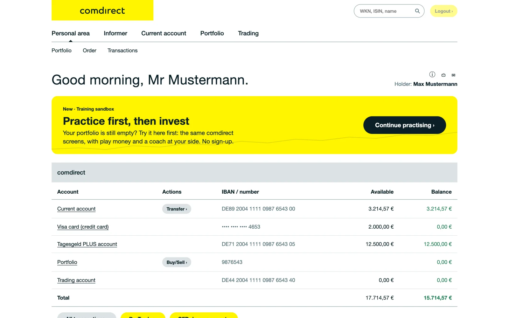
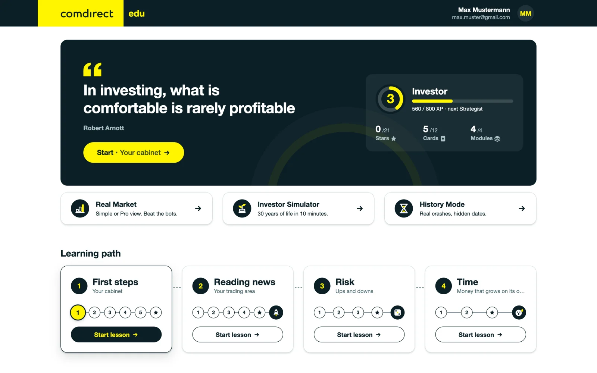
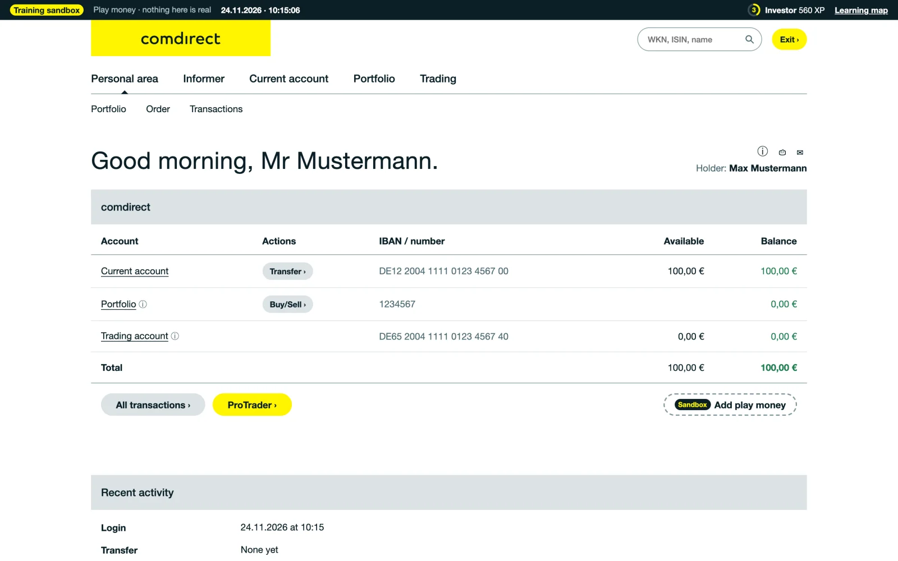
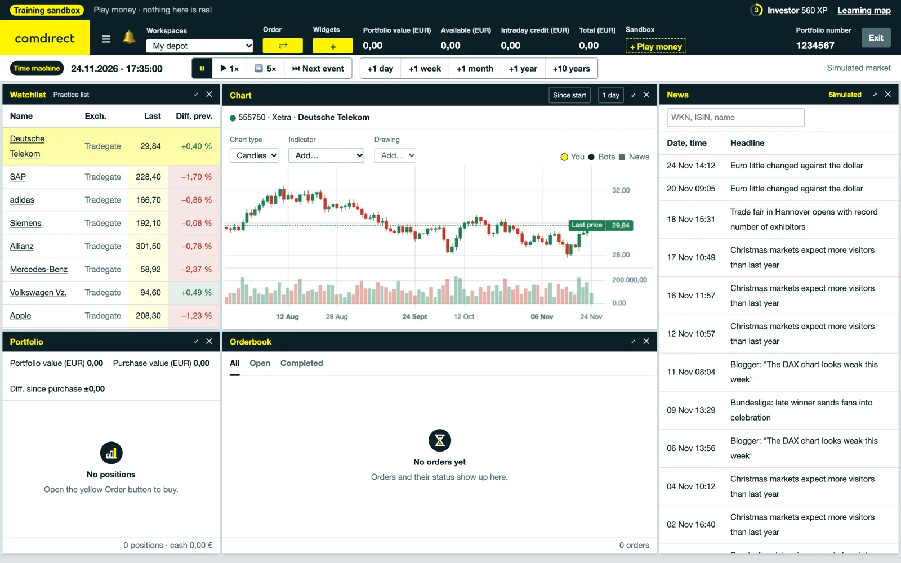

<p align="center">
  
</p>

<p align="center">
  
  
  
  
</p>

# comdirect edu

A training sandbox inside comdirect. It looks like the real comdirect screens, runs on play money and walks you through them one game step at a time, so buying your first stock feels like something you have already done.

**No theory first: you act from the very first minute, and every concept sticks because you just did it yourself.**

<table>
  <tr>
    <td width="50%"><br><sub><b>Entry:</b> one banner on the comdirect start page, no sign-up</sub></td>
    <td width="50%"><br><sub><b>Learning hub:</b> rank, XP, stars, cards and the four worlds</sub></td>
  </tr>
  <tr>
    <td width="50%"><br><sub><b>Web cabinet:</b> the comdirect customer area 1:1, on play money</sub></td>
    <td width="50%"><br><sub><b>ProTrader:</b> the full workspace plus our time machine</sub></td>
  </tr>
</table>

## Why

Germans save a lot but invest too little. The barrier is not information, it is fear of the first step: the trading screen is unfamiliar, the terms are unclear, and reacting to news feels risky.

comdirect already has the pieces, but they live apart:

| | Musterdepot | Akademie | **comdirect edu** |
|---|:---:|:---:|:---:|
| Play money | ✅ | — | ✅ |
| Real comdirect layout | partly | — | ✅ |
| Guidance on every element | — | — | ✅ |
| Learn by doing | — | — | ✅ |
| Consequences in seconds | — | — | ✅ |
| Fits your life stage | — | — | ✅ |
| Reason to come back | — | — | ✅ |

## What's inside

| Mode | What you do |
|---|---|
| **Guided tour** | A spotlight coach explains each element of the web cabinet in one or two sentences, then hands you a mission: top up, search, buy your first stock |
| **Market simulator** | One simple trading screen with a live news feed and time that moves |
| **ProTrader** | An exact replica of the comdirect ProTrader layout, so you are fluent in the real workspace before you buy your first stock |
| **History mode** | Replay real market moments and see how your decisions would have played out |
| **Investor simulator** | A life-long savings run: income, events and choices, decade by decade |
| **Learning map** | Worlds, concept cards, mini games, quick-check quizzes and bosses |

### One path, three life stages

Three onboarding questions pick a persona, and everything is tailored to it: examples, amounts, missions and bosses all match your life stage.

| Persona | Example | Start money | Savings plan | Focus |
|---|---|---:|---:|---|
| **Starter** | Lena, 22 | 100 € | 25 €/month | Compound interest, not chasing hype |
| **Builder** | Kaya family, 34 | 500 € | 50 €/month | Diversification, staying calm in a crash |
| **Pre-retiree** | Helga, 58 | 1.000 € | 100 €/month | Horizon, drawdown, why "cheap" isn't "safe" |

## How the game works

**The rule: we reward understanding and good decisions, never trading volume or guessing prices.** That keeps the game on the safe side of what regulators (ESMA, BaFin) criticise in "gamified" retail trading.

| Element | How it works |
|---|---|
| **Missions** | The coach steps back and you do it alone. 1–3 stars: done, done without hints, done with the smart choice (for example a limit order at night) |
| **XP and ranks** | XP for tour steps, missions, right concept answers and good decisions. Ranks: Saver → Beginner → Investor → Strategist → Market Reader |
| **Concept cards** | 12 to collect. Front: one sentence. Back: an example and a quiz question |
| **Rival bots** | AI traders on the same market, each with one bad habit: **FOMO Max** buys every hype, **Panic Paula** sells every dip, **All-in Alex** bets everything on one stock, **Steady Sam** runs a monthly ETF plan and is the benchmark |
| **Spot the habit** | When a bot trades you name the risk behind it, not whether the price will go up. XP for the right concept, whatever the outcome |
| **Mistake Cam** | After the outcome, a short replay of what the bot did, what really happened and the concept behind it |
| **Boss rounds** | Worlds 2–4 each end against one bot: FOMO Max, All-in Alex, Panic Paula. In History mode the same bosses return on real events with the date hidden (GameStop 2021, Wirecard 2020, the COVID crash 2020), revealed at the end |
| **Leaderboard** | You vs. the bots by risk-adjusted score (return − ½ × worst drawdown), so all-in gambling rarely wins |

## Fit with the Finance Quest challenge

| The challenge card asks for | What comdirect edu does |
|---|---|
| Bridge the gap between financial knowledge and action | You buy your first stock yourself, on the real comdirect screens, before you ever risk real money |
| A demonstrable prototype with a complete learning mission | World 1 mission **"Your first stock"**: move your money to the trading account, buy with a limit order, jump one week ahead, find your profit and loss. Checked against the sandbox state, not a quiz |
| The target learner and learning objective | **Learner:** self-directed savers who have never bought a stock. **Objective:** place a first trade with confidence and understand market vs. limit orders, fees and profit & loss |
| How the experience supports understanding and engagement | Spotlight tour where you do every step, concept cards, missions, rival bots, boss rounds, and History mode replays of real events |
| Fit with "Innovations for all generations" | Three onboarding questions pick a persona (22, 34 or 58), which changes the amounts, examples, missions and bosses |

## Why it's good for Commerzbank

- **Savers become investors.** Commerzbank's own Anlagestudie 2026 found that Germans save a lot and invest too little. edu turns the fear of the first step into a first trade.
- **A path into the real depot.** Every journey ends at **"Ready for real?"**, one click from the sandbox to the real comdirect portfolio.
- **Lives inside comdirect.** One banner on the start page. No sign-up, no new app, built on comdirect's own screens.
- **Customers for every life stage.** From a 22-year-old with a 25 € savings plan to a 58-year-old preparing for retirement.

## What we copy and what we invent

**Copied 1:1 from comdirect:** start page, account table, depot overview, transactions, search, security detail page, order form, and the ProTrader workspace with its widgets. Layout, element positions, table columns, field order and the German number and date formats (`1.001,16 EUR`, `14.03.2024`) match the real screens. All text is in English for now, so a German version only means swapping text.

**Invented by us:** the entry banner, onboarding and personas, the spotlight coach, missions, XP, ranks, cards and stars, the simple trading area between the web cabinet and ProTrader, the time machine, historical replays, rival bots, Spot the habit, Mistake Cam, boss rounds, the leaderboard and the clearly marked "Add play money" sandbox button.

## Quick start

```bash
npm install
npm run dev        # http://localhost:3000
```

```bash
npm run check      # self-check of the money math, scripted markets and bots
npm run build
```

Progress lives in `localStorage` (`cd-edu-v3`). "Reset progress" at the bottom of the hub starts over.

## Project structure

| Path | What |
|---|---|
| `src/app/` | Routes only: thin pages that render a feature screen |
| `src/features/market/` | Deterministic market and account (`engine.ts`), scripted lessons and historical replays, bots, news, companies. Runs under plain `node` for `npm run check` |
| `src/features/game/` | The save (XP, cards, stars, persona), personas and the tour UI bus |
| `src/features/tour/` | Chapters, missions, bosses, spotlight coach, plan comparison |
| `src/features/learn/` | Learning map, mini games, concept cards, history mode |
| `src/features/invsim/` | Investor simulator engine and events |
| `src/features/onboarding/` | Persona questions and the "ready" screen |
| `src/features/home/` | Mocked comdirect start page, entry banner, home switch |
| `src/features/cabinet/` | Web cabinet screens |
| `src/features/pro/` | Trading area, ProTrader widgets, chart, order window, replay |
| `src/features/shell/` | App header and sandbox bar |
| `src/shared/` | Shared `ui/`, `charts/` and `lib/` (format, rng) |
| `docs/replay-sources.md` | Fact-check notes and sources for the replays |

The full concept is in [`idea.md`](idea.md).

## Disclaimer

comdirect edu is a prototype built for Collabothon 2026. It is not an official comdirect or Commerzbank product. Everything runs on play money: no real accounts, orders or payments. Prices are mock data. Historical replays retell real events in short headlines of our own, and free play uses only simulated macro and sector news, labelled "Simulated". We never invent news about a real company.
