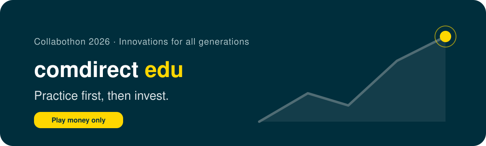

<p align="center">
  
</p>

<p align="center">
  
  
  
  
</p>

# comdirect edu

A training sandbox inside comdirect. It looks like the real comdirect screens, runs on play money and walks you through them one game step at a time, so buying your first stock feels like something you have already done.

**Learn → do it guided → do it alone → live with the consequences → real comdirect.**

## Why

Germans save a lot but invest too little. The barrier is not information, it is fear of the first step: the trading screen is unfamiliar, the terms are unclear, and reacting to news feels risky.

comdirect already has the pieces, but they live apart:

| | Musterdepot | Akademie | **comdirect edu** |
|---|:---:|:---:|:---:|
| Play money | ✅ | — | ✅ |
| Real comdirect layout | partly | — | ✅ |
| Guidance on every element | — | — | ✅ |
| Learn by doing | — | — | ✅ |
| Consequences in seconds | — | — | ✅ |
| Fits your life stage | — | — | ✅ |
| Reason to come back | — | — | ✅ |

## What's inside

| Mode | What you do |
|---|---|
| **Guided tour** | A spotlight coach explains each element of the web cabinet in one or two sentences, then hands you a mission: top up, search, buy your first stock |
| **Market simulator** | One simple trading screen with a live news feed, rival bots that make typical mistakes, and time that moves |
| **ProTrader** | The full comdirect-style workspace with a time machine that fast-forwards days, months or years |
| **History mode** | Replay real market moments and see how your decisions would have played out |
| **Investor simulator** | A life-long savings run: income, events and choices, decade by decade |
| **Learning map** | Worlds, concept cards, mini games, quick-check quizzes and bosses |

### One path, three life stages

Three onboarding questions pick a persona. The path is the same; examples, amounts, missions and bosses change.

| Persona | Example | Start money | Savings plan | Focus |
|---|---|---:|---:|---|
| **Starter** | Lena, 22 | 100 € | 25 €/month | Compound interest, not chasing hype |
| **Builder** | Kaya family, 34 | 500 € | 50 €/month | Diversification, staying calm in a crash |
| **Pre-retiree** | Helga, 58 | 1.000 € | 100 €/month | Horizon, drawdown, why "cheap" isn't "safe" |

## Quick start

```bash
npm install
npm run dev        # http://localhost:3000
```

```bash
npm run check      # self-check of the money math, scripted markets and bots
npm run build
```

Progress lives in `localStorage` (`cd-edu-v3`). "Reset progress" at the bottom of the hub starts over.

## Demo path (about 5 minutes)

1. `/` on first visit: the mocked comdirect start page with the yellow **"Practice first, then invest"** banner (also at `/comdirect`).
2. `/start`: three questions pick a persona. "Not you?" switches it.
3. `/` again, now the hub: your rank, the modes and the learning material per world.
4. **Start the tour** → `/cabinet`: transfer with photoTAN → search → stock page → order form → **mission: your first stock** → ⏩ 1 week → P/L → **Pro mode unlocked**.
5. `/pro`: the ProTrader workspace with the time machine. For the Wirecard moment, tick **Demo tools → Unlock all worlds** in the hub and open **👾 Boss: All-in Alex** in World 3.
6. The reveal shows the Mistake Cam and the risk-adjusted leaderboard.

## Project structure

| Path | What |
|---|---|
| `src/app/` | Routes only: thin pages that render a feature screen |
| `src/features/market/` | Deterministic market and account (`engine.ts`), scripted lessons and historical replays, bots, news, companies. Runs under plain `node` for `npm run check` |
| `src/features/game/` | The save (XP, cards, stars, persona), personas and the tour UI bus |
| `src/features/tour/` | Chapters, missions, bosses, spotlight coach, plan comparison |
| `src/features/learn/` | Learning map, mini games, concept cards, history mode |
| `src/features/invsim/` | Investor simulator engine and events |
| `src/features/onboarding/` | Persona questions and the "ready" screen |
| `src/features/home/` | Mocked comdirect start page, entry banner, home switch |
| `src/features/cabinet/` | Web cabinet screens |
| `src/features/pro/` | Trading area, ProTrader widgets, chart, order window, replay |
| `src/features/shell/` | App header and sandbox bar |
| `src/shared/` | Shared `ui/`, `charts/` and `lib/` (format, rng) |
| `docs/replay-sources.md` | Fact-check notes and sources for the replays |

The full concept is in [`idea.md`](idea.md).

---

<sub>Concept prototype built at Collabothon 2026. Not a live comdirect product; all money in the app is play money.</sub>
